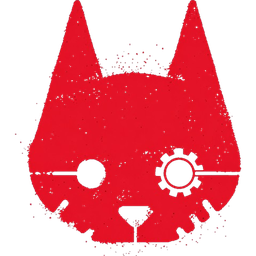
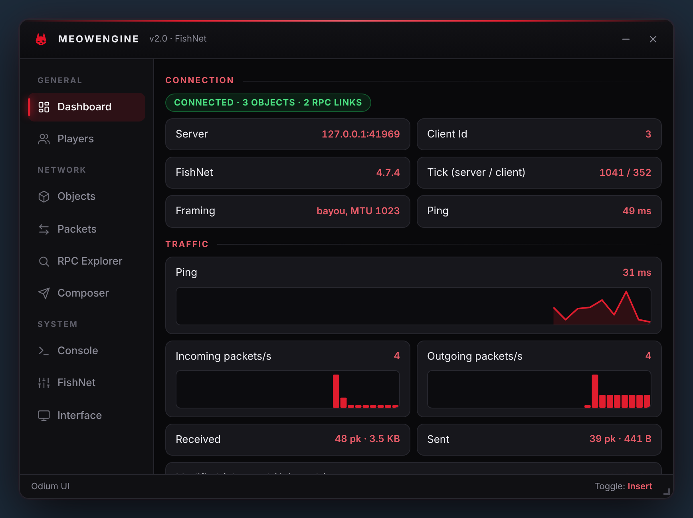
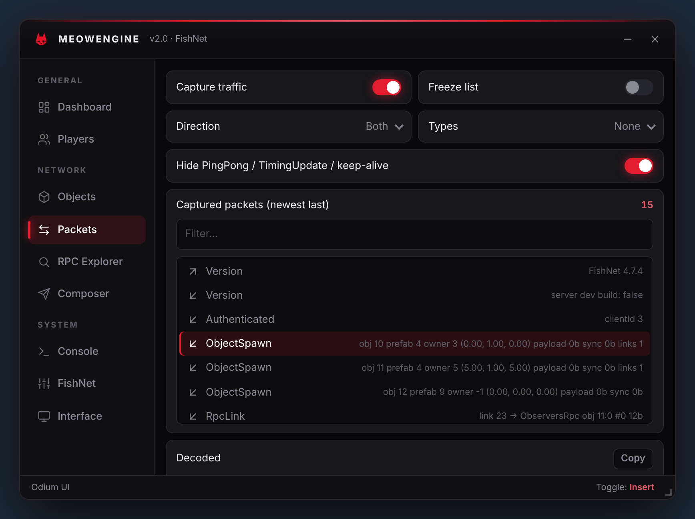
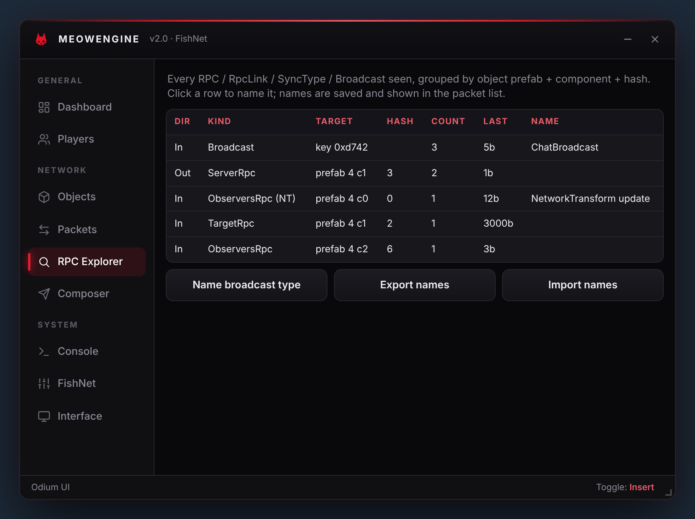
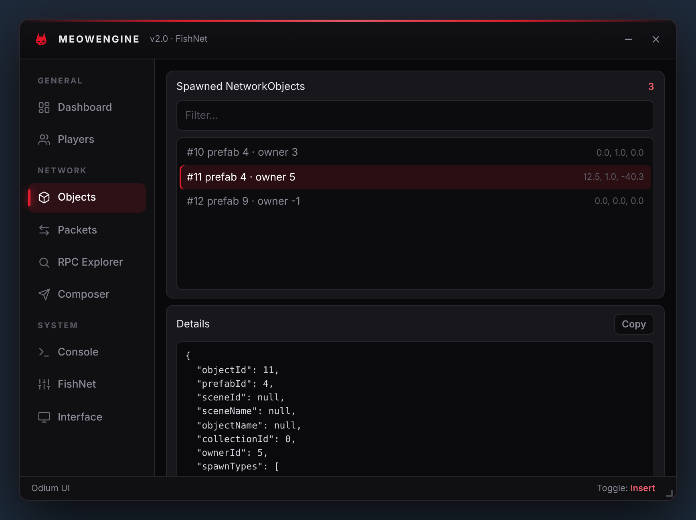
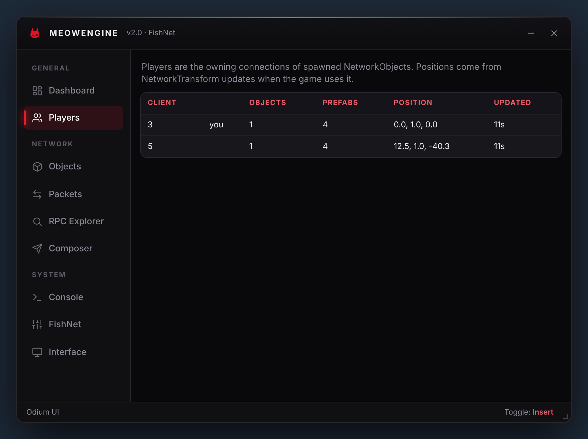
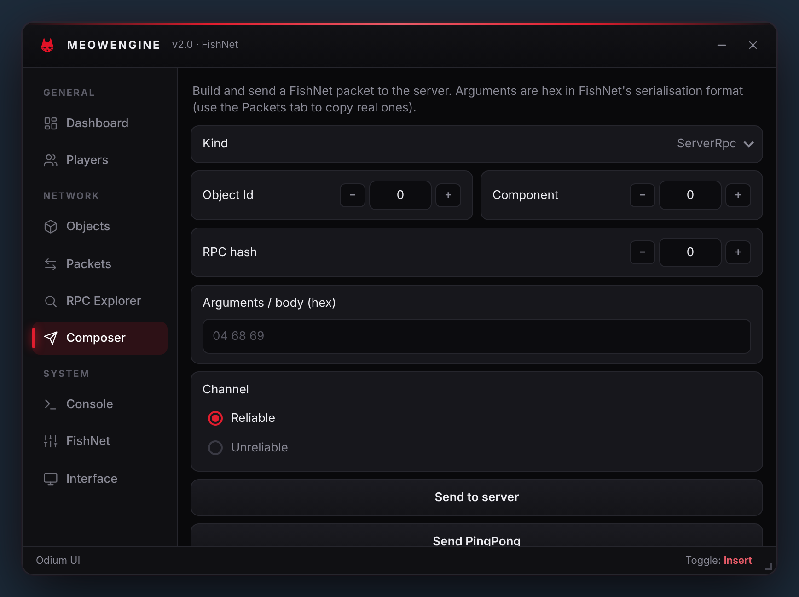
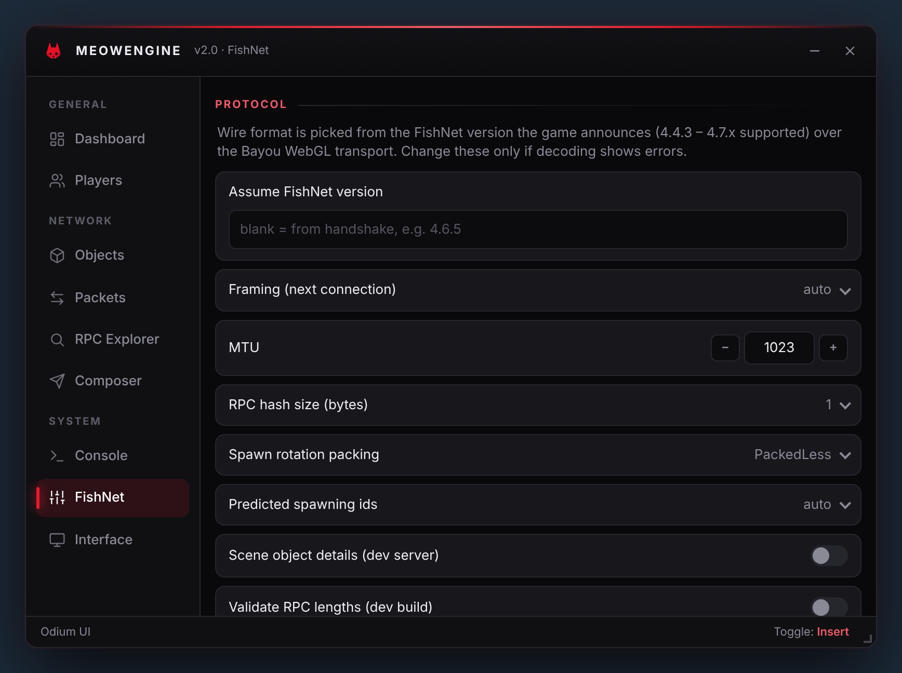

<div align="center">



# MeowEngine Parcel

**A Bullet Force mod base with a FishNet 4.x protocol SDK and an Odium UI menu, bundled into a single userscript.**




</div>

> [!WARNING]
> This project is intended for educational and personal use only.

## Table of Contents

- [Highlights](#highlights)
- [Screenshots](#screenshots)
- [Quick Start](#quick-start)
- [Using the Menu](#using-the-menu)
- [How It Works](#how-it-works)
- [Supported FishNet Versions](#supported-fishnet-versions)
- [SDK Reference](#sdk-reference)
- [Writing Patches](#writing-patches)
- [Player Management](#player-management)
- [Configuration](#configuration)
- [Project Structure](#project-structure)
- [Development](#development)
- [Troubleshooting](#troubleshooting)
- [Limitations](#limitations)
- [Changes in This Version](#changes-in-this-version)
- [Credits](#credits)
- [License](#license)

## Highlights

- **Real FishNet protocol.** Every packet FishNet sends is decoded and can be re-encoded: spawns, despawns, ServerRpc / ObserversRpc / TargetRpc, RpcLinks, SyncTypes, broadcasts, ping, timing, the version handshake and split messages. The format is taken from the FishNet sources and covers every release from 4.4.3 to 4.7.x.
- **Lossless pass-through.** Traffic you don't touch is forwarded byte-for-byte. A packet is only rebuilt when a hook edits it, and if decoding ever fails the original data goes through unchanged.
- **Version-aware.** The game announces its FishNet version in its first message, and the matching wire format is selected automatically.
- **Live network mirror.** Your client id, ticks, ping, every spawned object and its owner, RpcLinks, and positions read from NetworkTransform.
- **Hooks in both directions.** Read, edit, drop or inject packets on the way in and on the way out.
- **Odium UI menu.** Dashboard, player list, object browser, packet inspector, RPC explorer and packet composer.
- **Tested.** 50 codec unit tests, plus an end-to-end run that drives the built userscript in headless Chromium against a fake FishNet server.

## Screenshots

<table>
  <tr>
    <td align="center"><br><sub><b>Packets</b>: live decoder with filters, JSON and hex</sub></td>
    <td align="center"><br><sub><b>RPC Explorer</b>: every RPC seen, nameable</sub></td>
  </tr>
  <tr>
    <td align="center"><br><sub><b>Objects</b>: spawned NetworkObjects and details</sub></td>
    <td align="center"><br><sub><b>Players</b>: connections, objects and positions</sub></td>
  </tr>
  <tr>
    <td align="center"><br><sub><b>Composer</b>: build and send packets</sub></td>
    <td align="center"><br><sub><b>FishNet</b>: protocol and interception settings</sub></td>
  </tr>
</table>

<sub>The screenshots come from `pnpm screenshots`, which runs the menu against the fake server used by the end-to-end test.</sub>

## Quick Start

### Install the prebuilt script

1. Install a userscript manager such as [Tampermonkey](https://www.tampermonkey.net/) or [Violentmonkey](https://violentmonkey.github.io/).
2. Open `dist/meowengine.user.js` and install it.
3. Open Bullet Force on CrazyGames. The menu appears once the page loads; press **Insert** or **V** to toggle it.

### Build from source

Requires [Node.js](https://nodejs.org/) 16+ and [pnpm](https://pnpm.io/).

```bash
git clone https://github.com/cyberarchives/meowengine-parcel.git
cd meowengine-parcel
pnpm install
pnpm build            # -> dist/meowengine.user.js
```

If you can't use npm, [Bun](https://bun.sh/) can build the same userscript with no dependencies installed:

```bash
bun scripts/build-bun.js
```

## Using the Menu

| Key | Action |
| --- | --- |
| `Insert` / `V` | Show or hide the menu (the toggle key can be changed under **Interface**) |

While the menu is open, a transparent overlay stops clicks from reaching the game, so the cursor stays free. You can turn this off under **FishNet → Menu**.

| Tab | What it shows |
| --- | --- |
| **Dashboard** | Connection status, server, FishNet version, client id, ticks, ping, packet-rate charts and traffic totals |
| **Players** | One row per connection that owns spawned objects, with position and last update. Click a row to see that player's objects |
| **Objects** | Every spawned NetworkObject: prefab or scene id, owner, transform, RpcLinks and RPC activity |
| **Packets** | Live decoded traffic, filtered by direction and type, with decoded JSON, a hex dump and export buttons |
| **RPC Explorer** | Every RPC, RpcLink, SyncType and broadcast seen, grouped by prefab, component and hash. Click a row to name it |
| **Composer** | Build and send a ServerRpc, a broadcast or raw packet bytes |
| **Console** | The MeowEngine log |
| **FishNet** | Protocol overrides, interception and caching settings |
| **Interface** | Theme, accent colour, opacity, toggle key and config save/load |

Names you give in the RPC Explorer are saved in `localStorage` and appear throughout the menu. Use **Export names** and **Import names** to share them.

## How It Works

```
 game (Unity WebGL / Bayou jslib)
        │  new WebSocket(...)
        ▼
 ┌─────────────────────────── FishNetSocketManager ───────────────────────────┐
 │  outgoing: ws.send ─► parseFrame ─► hooks ─► encodeFrame ─► native send    │
 │  incoming: onmessage ◄─ encodeFrame ◄─ hooks ◄─ parseFrame ◄─ native recv  │
 │                     │                                                      │
 │                     └─► NetworkState (objects, owners, links, ping, stats) │
 └────────────────────────────────────────────────────────────────────────────┘
```

1. At startup, `window.WebSocket` is replaced with a subclass. This happens before Unity loads, so the game-server connection is always caught.
2. A socket is treated as FishNet once its first outgoing message decodes as a FishNet `Version` handshake. All other sockets pass through untouched.
3. Each WebSocket message is one FishNet datagram:

   ```
   [u32 tick][packet][packet]…[channel byte]
   ```

   Bayou appends the channel byte. Messages that are split are reassembled before hooks run, and split again if an edit pushes them over the MTU.
4. The decoded packets update `NetworkState`, then go through your hooks. Only packets that changed are re-serialised.

The full protocol is documented in [`docs/FISHNET_PROTOCOL.md`](docs/FISHNET_PROTOCOL.md): framing, primitive encodings, every packet id, the RPC and spawn layouts, NetworkTransform, and the differences between versions.

## Supported FishNet Versions

| FishNet | Status | Format differences handled |
| --- | --- | --- |
| 4.6.9 – 4.7.x | ✅ Decoded | Current format |
| 4.6.6 – 4.6.8 | ✅ Decoded | 1-byte predicted-id count; legacy 64-bit varint |
| 4.6.3 – 4.6.5 | ✅ Decoded | Spawn `initializeOrder` is an `sbyte` |
| 4.5.6 – 4.6.2 | ✅ Decoded | RpcLink kind is a 1-byte `RpcType` flag |
| 4.4.3 – 4.5.5 | ✅ Decoded | `PredictedSpawnResult` carries RpcLinks |
| < 4.4.3 | ⏭️ Pass-through | Different spawn, SyncType and varint layout; traffic is forwarded without decoding |

Each row also includes the differences of every row above it. To force a profile, set **FishNet → Assume FishNet version**.

## SDK Reference

Everything is available at runtime under `window.MeowEngine`:

| Path | Description |
| --- | --- |
| `MeowEngine.FishNet` | The SDK namespace: all exports of `src/FishNet/index.js` |
| `MeowEngine.FishNetClient.Instance` | High-level client API (see below) |
| `MeowEngine.Events.FishNet` | The socket manager and event emitter |
| `MeowEngine.FishNet.FishNetSocketManager.state` | The live `NetworkState` |
| `MeowEngine.Config.FishNet` | Runtime configuration ([Configuration](#configuration)) |
| `MeowEngine.RoomInstance.Players` | Player list built from FishNet state |
| `MeowEngine.Menu.ui` | The Odium UI instance |

### `FishNetClient`

| Method | Description |
| --- | --- |
| `serverRpc({ objectId, componentIndex, hash, args, channel })` | Send a ServerRpc. `args` is bytes or a `FishWriter` |
| `broadcast(type, data, channel)` | Send a broadcast. `type` is the C# type `FullName` (hashed the way FishNet does) or the numeric 16-bit key |
| `send(packets, { channel })` | Send raw packet objects to the server |
| `inject(packets, { channel })` | Deliver packets to the game as if the server had sent them |
| `ping()` | Send a `PingPong` with the current client tick |
| `writer()` / `reader(bytes)` | A `FishWriter` / `FishReader` set up for the connected FishNet version |
| `networkTransformArgs({ position, rotation, scale })` | Build NetworkTransform RPC arguments |
| `isConnected`, `connectionId`, `state` | Connection info |

### Protocol building blocks

| Export | Description |
| --- | --- |
| `FishReader`, `FishWriter` | Ports of FishNet's `Reader` and `Writer`: packed integers, strings, collections, vectors, 32/64-bit quaternions, NetworkObject / NetworkBehaviour / connection references |
| `Packets.*` | Packet builders: `serverRpc`, `observersRpc`, `targetRpc`, `rpcLink`, `broadcast`, `syncType`, `ownershipChange`, `despawn`, `pingPong`, `version` |
| `parseFrame`, `encodeFrame`, `buildFrames`, `parseMessage` | Transport framing, MTU batching and split handling |
| `readPacket`, `writePacket`, `encodePacket` | Single-packet codec |
| `PacketId`, `Channel`, `SpawnType`, … | Enums |
| `broadcastKey(fullName)` | FishNet's broadcast key: FNV-1 of the type name, folded to 16 bits |
| `decodeTransformData`, `tryDecodeTransformRpcArgs` | NetworkTransform decoding |
| `describePacket`, `packetToJSON`, `hexDump` | Inspection helpers |

### Decoded packet shape

Every packet has `id`, `name`, `direction` (`'in'` = server → client, `'out'` = client → server), `channel` and `raw` (its original bytes). Depending on the type it also has:

| Packet | Fields |
| --- | --- |
| RPCs (`ServerRpc`, `ObserversRpc`, `TargetRpc`, `Replicate`, `Reconcile`) | `objectId`, `componentIndex`, `hash`, `args`, `hasLength`, `rpcName` |
| `RpcLink` (ids ≥ 22) | `linkIndex`, `link`, `linkedTo`, `objectId`, `componentIndex`, `hash`, `args` |
| `ObjectSpawn` | `objectId`, `prefabId` or `sceneId`, `ownerId`, `spawnTypes`, `nested`, `localPosition`, `localRotation`, `localScale`, `payload`, `rpcLinks`, `syncTypes` |
| `SyncType` | `objectId`, `componentIndex`, `data` |
| `Broadcast` | `key`, `broadcastName`, `data` |
| `Authenticated` | `connectionId`, `predictedObjectIds` |
| `Version` | `version` (out) or `isServerDevelopment` (in) |
| `PingPong`, `TimingUpdate` | `tick` |

Data that a generic parser can't decode, such as unreliable RPCs with no length prefix or corrupt bytes, ends up in an `Opaque` packet that is forwarded unchanged.

## Writing Patches

Hooks get a context for each frame:

| Member | Description |
| --- | --- |
| `ctx.packets` | Decoded packets in the frame |
| `ctx.direction` | `'in'` or `'out'` |
| `ctx.frame` | `tick`, `channel`, `size`, `errors` |
| `ctx.state` | The `NetworkState` |
| `ctx.modify(pkt)` | Mark an edited packet so it is re-serialised |
| `ctx.dropPacket(pkt)` / `ctx.drop()` | Remove one packet, or the whole frame |
| `ctx.inject(pkt)` | Append a packet to this frame |
| `ctx.find(id)` | Packets with the given `PacketId` |

Events: `connected`, `disconnected`, `incoming`, `outgoing`, `packet`, `packet:<Name>`, `capture` and `error`. Older patch code that listens on `MeowEngine.Events.OnMessage` (incoming) or `SendMessage` (outgoing) receives the same context.

**Log every outgoing RPC**

```js
import { FishNetSocketManager } from './FishNet/FishNetSocketManager.js';

FishNetSocketManager.addListener('packet:ServerRpc', ({ packet }) => {
  console.log(`ServerRpc obj ${packet.objectId}:${packet.componentIndex} #${packet.hash}`, packet.args);
});
```

**Decode and rewrite a game RPC**

```js
FishNetSocketManager.addListener('outgoing', (ctx) => {
  for (const p of ctx.packets) {
    if (p.name !== 'ServerRpc' || p.hash !== 3) continue;
    const client = MeowEngine.FishNetClient.Instance;
    const text = client.reader(p.args).readString();          // the game's first parameter
    p.args = client.writer().writeString(text.toUpperCase()).toBytes();
    ctx.modify(p);
  }
});
```

**React to a named broadcast**

```js
const state = FishNetSocketManager.state;
const key = state.registerBroadcast('Game.Net.ChatBroadcast', 'Chat');

FishNetSocketManager.addListener('packet:Broadcast', ({ packet }) => {
  if (packet.key === key) console.log('chat', MeowEngine.FishNetClient.Instance.reader(packet.data).readString());
});
```

**Follow object movement**

```js
state.addListener('transform', (obj) => console.log(obj.objectId, obj.position));
state.addListener('spawn', (obj) => console.log('spawned', obj));
```

> [!TIP]
> RPC hashes are the RPC's index within its NetworkBehaviour type, so the same hash means different things on different prefabs. Use the RPC Explorer to find the prefab, component and hash for the action you care about, then give it a name.

## Player Management

`MeowEngine.RoomInstance.Players` is rebuilt from FishNet state, with one entry per connection that owns spawned objects. Use `state.getClients()` for the raw grouping.

| Property | Description |
| --- | --- |
| `clientId` / `actorNr` | FishNet connection id |
| `isLocal` | `true` for your own connection |
| `objectId`, `objectIds`, `prefabIds` | The NetworkObjects this connection owns |
| `position`, `rotation`, `lastUpdate` | Latest NetworkTransform update from one of its objects |
| `name`, `rank`, `kd`, `team`, `kills`, `health`, `platform` | Placeholders. These are game data, sent in Bullet Force's own RPCs and SyncTypes; fill them in once you've identified those messages |

```js
const players = MeowEngine.RoomInstance.Players;
const me = players.find((p) => p.isLocal);
```

## Configuration

`MeowEngine.Config.FishNet`, editable from the **FishNet** tab:

| Option | Default | Description |
| --- | --- | --- |
| `framing` | `'auto'` | `'bayou'`, `'raw'` or `'auto'` (detected from the handshake) |
| `mtu` | `1023` | Bayou MTU. Raised automatically if the game sends larger frames |
| `assumeVersion` | `''` | Force a FishNet version profile instead of using the handshake |
| `rpcHashSize` | `1` | `2` only if a NetworkBehaviour has more than 255 RPCs |
| `spawnRotationPacking` | `2` | `ServerManager.SpawnPacking.Rotation` (0 Unpacked, 1 Packed, 2 PackedLess) |
| `predictedSpawning` | `'auto'` | Whether `Authenticated` carries predicted object ids |
| `sceneObjectDetails` | `false` | Development servers with `WriteSceneObjectDetails` |
| `validateRpcLengths` | `false` | Development builds with `ValidateRpcLengths` |
| `decode` | `true` | `false` passes everything through untouched and disables hooks |
| `capture`, `captureLimit` | `true`, `2000` | Inspector ring buffer |
| `debugIncomingPackets`, `debugOutgoingPackets` | `false` | Log frames to the browser console |
| `urlHint` | `'blayzegames'` | Treat sockets to matching URLs as FishNet even if the handshake was missed |

## Project Structure

```
meowengine-parcel/
├── src/
│   ├── index.js                     # entry: installs the hook, patches and menu
│   ├── FishNet/
│   │   ├── Enums/                   # PacketId, Channel, SpawnType, …
│   │   ├── Protocol/
│   │   │   ├── FishReader.js        # FishNet Reader port
│   │   │   ├── FishWriter.js        # FishNet Writer port
│   │   │   ├── PacketCodec.js       # per-packet decode/encode
│   │   │   ├── Framing.js           # tick + channel framing, MTU, split
│   │   │   ├── Versions.js          # per-version wire differences
│   │   │   ├── NetworkTransform.js
│   │   │   ├── Quaternion.js
│   │   │   └── Hashing.js
│   │   ├── State/NetworkState.js    # live session mirror and saved names
│   │   ├── Patching/FishNetPatching.js
│   │   ├── FishNetSocketManager.js  # WebSocket hook and hooks pipeline
│   │   ├── FishNetClient.js         # high-level API
│   │   ├── Inspect.js               # JSON / hex helpers
│   │   └── index.js
│   ├── UI/MeowMenu.js               # the menu
│   ├── OdiumUI/                     # Odium UI library (vendored)
│   ├── Browser/                     # globals, logging, Unity helpers
│   ├── Bullet Force/                # game web API helpers
│   └── Photon/ Patches/ MeowEngine/ # legacy Photon code, kept for reference
├── assets/icon.png                  # app icon (source for all icon sizes)
├── docs/
│   ├── FISHNET_PROTOCOL.md          # protocol write-up
│   └── images/                      # README screenshots and logo
├── tests/
│   ├── fishnet.test.js              # codec unit tests
│   └── e2e/run.js                   # fake server + headless Chromium
├── scripts/
│   ├── build-bun.js                 # dependency-free build
│   └── make-icons.py                # regenerates icon sizes from assets/icon.png
├── header.js                        # userscript metadata block
└── bundle.js                        # prepends the header after a Parcel build
```

## Development

| Command | Description |
| --- | --- |
| `pnpm build` | Production build with Parcel → `dist/meowengine.user.js` |
| `pnpm dev` | Parcel watch mode |
| `pnpm build:bun` | The same build using Bun |
| `pnpm test` | Codec unit tests (Bun) |
| `pnpm test:e2e` | Builds, then runs the userscript in headless Chromium against a fake FishNet server |
| `pnpm screenshots` | Regenerates `docs/images/*.png` |
| `python3 scripts/make-icons.py` | Regenerates the userscript icon, window logo and README logo from `assets/icon.png` |
| `pnpm readme-tree` | Prints the source tree (the legacy README generator) |

The end-to-end test uses Bun and Playwright with the Chromium build installed alongside Playwright. It checks:

- incoming messages reach the game byte-for-byte
- the handshake is detected
- spawns, RpcLinks and NetworkTransform positions are tracked
- edits made by hooks are still valid FishNet in both directions
- `inject()` delivers well-formed frames
- split messages are reassembled
- the Bayou keep-alive passes through untouched
- the menu loads with no page errors

## Troubleshooting

<details>
<summary><b>The dashboard stays on “Waiting for FishNet connection”</b></summary>

The hook only applies to sockets created after the script runs. Make sure the userscript runs inside the game iframe (`bullet-force-multiplayer.game-files.crazygames.com`), then join a match. The game only opens its FishNet connection when you join.
</details>

<details>
<summary><b>The Packets tab shows <code>Opaque</code> packets or the error counter rises</b></summary>

Check the FishNet version on the Dashboard. If it shows a version the game doesn't really use, set **Assume FishNet version**. If spawns fail to decode, try a different **Spawn rotation packing**; the game can change it in its `ServerManager`.
</details>

<details>
<summary><b>I get kicked after sending a packet from the Composer</b></summary>

The server validates everything: object ownership, RPC hashes, argument layout and MTU. Copy a real packet's bytes from the Packets tab and change it step by step.
</details>

<details>
<summary><b>Player names, ranks or health are empty</b></summary>

They aren't part of FishNet. They live in Bullet Force's own RPCs and SyncTypes. Find those in the RPC Explorer, decode them with `FishReader`, and fill the player entries in a patch.
</details>

## Limitations

- Game-specific data (RPC arguments, SyncType values, spawn payloads, broadcast bodies) comes out of the game's generated serializers. The SDK gives it to you as bytes, labelled with prefab, component, hash and broadcast key, but can't name the fields on its own.
- An RPC sent on the unreliable channel has no length prefix, so it is shown as extending to the end of its frame.
- FishNet versions before 4.4.3 are passed through without decoding.
- `src/MeowEngine/Bot/FishNetBot.js` still uses the old placeholder protocol and is not part of the build.

## Changes in This Version

The following changes were made to the original MeowEngine Parcel:

- Replaced the placeholder FishNet layer (it sent invented JSON messages and never parsed real traffic) with a binary implementation of the FishNet 4.x protocol: codec, framing, version profiles, state mirror, hooks and client API.
- Replaced the `src/Menu` UI (UIManager, components and canvas overlays) with Odium UI and a new menu in `src/UI/MeowMenu.js`.
- Odium UI (vendored in `src/OdiumUI`) gained inline SVG icon support, SVG window buttons and an optional, hidden-by-default window logo; the menu uses a consistent line-icon set (`src/UI/icons.js`).
- The WebSocket hook is now installed at startup instead of after Unity loads, and the wait for Unity now allows up to 5 minutes instead of 10 seconds.
- Added the MeowEngine logo as the userscript icon, window icon and README logo.
- Added the protocol documentation, unit and end-to-end tests, a Bun build script and the README screenshots.
- `HttpRequestManager` now clears the FishNet player list instead of the removed Photon overlay.
- `pnpm build` no longer regenerates this README; `lib/tree.js` is available as `pnpm readme-tree`.

## Credits

- **MeowEngine** by **Nyxi**. © 2025-2026 Nyxi. See [LICENSE](LICENSE.md).
- **[FishNet](https://github.com/FirstGearGames/FishNet)** by FirstGearGames. The protocol implementation follows its sources.
- **[Bayou](https://github.com/FirstGearGames/Bayou)**: FishNet's WebGL WebSocket transport.
- **Odium UI**: the in-page UI toolkit used for the menu.

## License

MIT License with attribution requirements. See [LICENSE.md](LICENSE.md). Modified versions must credit Nyxi and state what changed. Third-party components keep their own licenses (see the notices at the end of the license).
